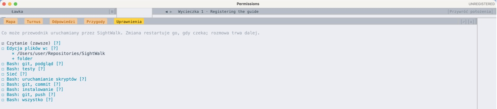
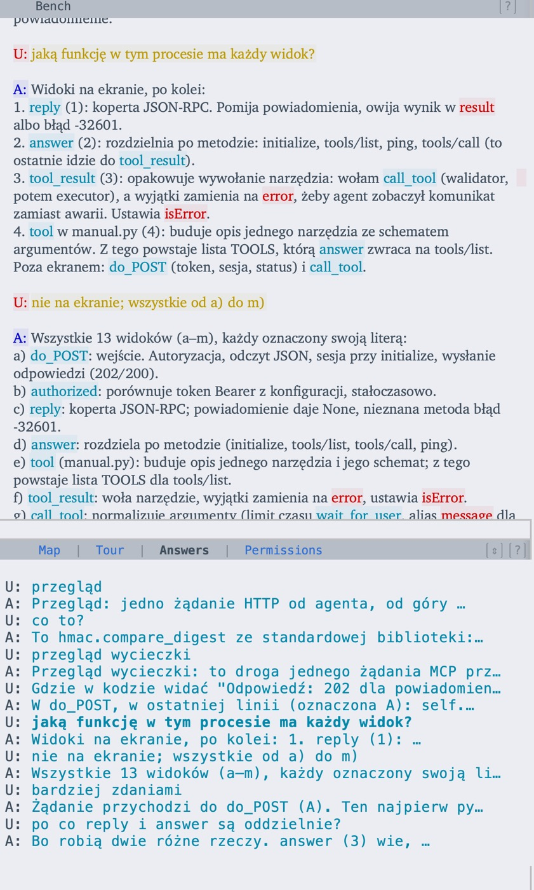

# SightWalk

**Vet generated code on a trip an AI guide lays out just for you.**

*Po polsku: [README.pl.md](README.pl.md).*

SightWalk is a Sublime Text plugin. You ask a question about your code; an AI agent, the
**guide**, composes a **trip** that answers it: it picks the functions involved and lays them
out in one column, most often one run of the program, function after function, in the order
control passes through them. Then it walks you through the trip, explains it and marks lines,
while you talk with it in a conversation pane next to the code.

The guide is any agent that speaks MCP: Claude Code, which SightWalk can start by itself, or
another agent, a local model included. It need not be the agent that wrote the code.


*Every screenshot here comes from a real session: the plugin vetting its own code. The other
conversations are as they happened, in Polish.*

*Status: public alpha (October 2026). It works daily on its own code; expect rough edges.*

---

## Why

AI writes code faster than people can read it. The bottleneck has moved from writing to
**vetting**: knowing that what was generated does what you asked, and nothing else.

Reading generated code in an ordinary editor is slow because the code is laid out the way it
is *stored*: by file, and in each file top to bottom. A question like "what happens when a
request arrives?" means jumping between five files, losing your place each time, and holding
the whole path in your head.

In SightWalk a guide lays the code out the way it is *executed*, or the way your question
needs it, and stays beside you to answer for every line.

## The idea in four words

The plugin borrows the vocabulary of sightseeing:

| Term | What it is |
|---|---|
| **Sight** | One pane: a line range of a file, one function at most, whole or a fragment. |
| **Trip** | A sequence of sights chosen for one question, read top to bottom. Also the reader window itself. |
| **Vetting guide** | The AI agent: it chooses the trip, explains it, marks lines, and answers. |
| **Vetting Bench** | The conversation pane where you talk with the guide. |

A trip is one of three kinds:

- **a run**: one run of the program, sights in the order control passes through them;
- **a comparison**: fragments side by side, e.g. two implementations, or code before and after a change;
- **a survey**: all the places about one thing, e.g. every handler of one error.

Trips can be saved, joined into an **informator** (a network of trips covering the whole
program's code, with transitions between them), and chosen ones walked in a set order as a
**tour**. The plugin's own code is documented this way: [docs/trips.md](docs/trips.md) splits it
into a full tour of 43 trips, and puts every function in one at least.

## A walk through the interface

### The trip

On the right, the **Sights**: one column of panes, scrolled as one document. Each sight has a
header with its name, (a), (b), (c)…, and its file, tinted in a hue per file. The `def` and
`class` lines a fragment belongs to stay frozen under its header, and "⋮ 10 lines of Handler"
says what was left out. The column moves as one document, every header with its code, while the bench
stays put: the wheel moves it over the scroll strip, and over the bench and the Tools pane when `⌘S` sets
it so. Over a sight's code the wheel scrolls that sight alone.

On the left, the **Vetting Bench**. At the top of this page the user asks *why does the client
get 202 **here** and not 200?*, with "here" linked to line 105. The guide answers with marks:
icons **1** and **2** on the two lines of `reply` that drop a notification, a jump **comes
back** from `return None` to line 105, icon **3** on that line, and a jump **asks answer** for
the other branch. In the Tour screenshot below, the user asks *why are reply and answer
separate?*. Names of functions on the bench are coloured as in the code.

Three voices speak on the bench. **P:** is the trip's **Pioneer**, who laid the trip out,
cleared the way through the code or explored it as found, and not always the code's author:
the bench of every new trip opens with the Pioneer's story of it. **U:** is you, the
**user**. **A:** is the **AI agent**, your **guide**, who may be another than the Pioneer and,
when the job is stern vetting, no friend of the Pioneer's.

◀ ▶ (⌘[ ⌘]) step through a window's trips, each with its own conversation. An **adventure**
is a turn off the trail for a flower worth a closer look: the guide opens a short trip in a
window over the one shown, and the **Adventures** tab opens past ones again, as they were left.

### Every reference is a link

Guide and user share one markup. The guide ties its words to places with
`<here at="(c):34" icon="1">this check</here>` (the line gets icon 1), `<here at="(c):34:12-16">this
name</here>` (characters, no icon) or `<calls at="(a):33 (b):41">calls</calls>` (a jump; the same
for every transition type). You see the words framed in the mark's colour, an icon's sign after
them, and the line gets the same icon in the gutter (a second
mark on the same line stands on the narrow strip left of the sights). A mark scrolled off screen
leaves an eye on the nearest visible line, so it is never lost. Clicking a framed word selects
what it refers to (both ends of a jump) and lights the same arrow on the Map; clicking again
takes the selection off.

You can link the other way too. Select words in your draft, select code, press `⌘P` (`Ctrl+P`),
and the guide receives your message with that link as `<here at="(c):34-36">this check</here>`.
A message sent without links carries whatever you have selected in the code, so "why is *this*
here?" always means what you are looking at, never a guess.

### The Map


The Tools pane under the bench draws the trip as a call graph (with Graphviz): every sight a box
in its class and file, every transition the guide named an arrow, each type drawn its own way:
`calls`, `returns`, `leads_to`, `passes_data`, `unblocks` (understood first), `comparable`.
The Map shows exactly what the guide declared and never guesses: when the drawing is wrong,
the guide's account is wrong, which is itself a finding.

### Tours


**SightWalk: Open Tour** lists the tours found in the open folders. The Tour tab shows the trips
in order; you tick a trip as walked yourself. Each trip keeps its own conversation and the
guide's marks, so a walk goes on where it stopped.

### Editing in place


`Enter` in a sight opens the real file right over the trip, at the same lines.
Save, and the trip reloads: every sight at its new range, every mark on its new line, and the
guide's next message tells it which ranges changed. `Esc` puts the editor away and the panes
return to where they were.

### What the guide may do



When you ask a question on the bench with no guide connected, SightWalk starts one: a Claude
Code session in the background, in the trip's repository. By default it can only read code.
The Permissions tab raises that per purpose, each field with a `[?]` saying exactly what it
allows: editing files (in folders you name), sets of shell commands (git inspection, tests,
scripts, committing, installing, pushing), web lookups. Choices that cannot be undone, such as
`git push` and unrestricted shell, last one session only and are never remembered. A change
restarts the guide with the conversation intact. If the guide needs more, it says so on the
bench and names the field. The reasoning behind the sets is in
[docs/guide-permissions.md](docs/guide-permissions.md).

### Answers



The Answers tab lists every question and answer on the bench by its first words. A click brings
one to the top of the bench with its marks (a question: what you had selected when you sent
it); a second click hides them and puts the bench back where it was.

## How it is built

```
Guide agent ──MCP over HTTP──▶ subl_mcp_http ──▶ validator (pure) ──▶ subl_executor ──▶ Sublime
                                 the plugin itself                       reader, bench, map
```

- **The plugin is the MCP server.** No separate process: an HTTP server with a bearer token,
  inside Sublime's own Python 3.8 host, on the standard library only.
- **Every call is judged before it acts.** A pure `validator` module refuses a call that breaks
  a rule, and its message says what to do instead. For example, `show` refuses a sight holding two
  functions, and `say` refuses a line given three marks. The executor gathers the facts; the
  validator only judges them. Agents learn from these refusals within a session.
- **Pure core, thin Sublime layer.** Modules without the Sublime API (`spec`, `plan`, `marks`,
  `ontology`, `callmap`, `validator`, `manual`, `permissions`…) hold the logic and are unit
  tested with plain Python. Modules prefixed `subl_` do only what needs the editor, so a port
  to another editor starts from the same core.
- **An ontology, not ad-hoc lists.** Sights, trips, informators and tours are one hierarchy of
  collections with typed transitions between places (`sw/ontology.py`); trip files are its
  JSON form.
- **Vetted with itself.** Functions are kept to about 25 lines so each fits one sight. The
  script `tools/trips.py` writes the plugin's own code as trips and names any function no trip
  covers, so the documentation cannot silently fall behind the code.

About 6,200 lines of Python in 31 modules, 341 commits since 4 October 2026.

## How it was made

**Concept and design: Jakub Kozakoszczak. Code: written by Claude** (Anthropic's model, in
Claude Code).

That split is the method, not a footnote. Jakub designs every behaviour, decides, and checks
each change in Sublime; Claude implements, tests and proposes alternatives with reasons. The
working agreements are in [CLAUDE.md](CLAUDE.md). Every design decision, its reason and its
current status are in [DECISIONS.md](DECISIONS.md), newest first, marked verified, changed but
unverified, or open. Nothing is reported as working until the designer has seen it work.

SightWalk is also the tool this way of working needed: AI-written code you can follow, question
and trust.

## Installing (alpha)

Requirements: macOS, Linux or Windows; [Sublime Text 4](https://www.sublimetext.com/);
[Claude Code](https://claude.com/claude-code); for the Map,
[Graphviz](https://graphviz.org/) (`brew install graphviz`).

1. Put the repository into Sublime's packages, for example by a symlink (macOS shown):
   ```bash
   ln -s "$PWD" ~/Library/Application\ Support/Sublime\ Text/Packages/SightWalk
   ```
2. In Sublime, run **SightWalk: Set Up Agent Bridge** from the command palette. It creates a
   token and puts the registration command on your clipboard.
3. Paste and run that command in a terminal (`claude mcp add … sight-walk …`).
4. Open a Claude Code session in your project and ask, for example: *"Use sight-walk to walk me
   through what happens when a request arrives, then wait for my questions."* Or type your
   question on the bench of an empty trip (`⌘G` / `Ctrl+G` when bound) and SightWalk starts a
   guide itself.

### Keys

| Key | In a trip |
|---|---|
| `⌘Enter` / `Enter` | send your message from the bench |
| `⌘P` | link selected words to selected code |
| `Enter`, `Esc` | open the editor on a sight, close it |
| `Alt+R` | reset positions |
| `⌘S` | switch what the wheel over the bench and the Tools pane does: scroll the trip, or that pane |
| `Ctrl+Tab` | focus the next sight on screen |
| `Alt+↑↓`, `PgUp`/`PgDn` | scroll the trip |

`⌘` is `Ctrl` on Windows and Linux. The interface speaks English and Polish
(**SightWalk: Switch Language**).

## Status and limits

- Alpha, built and used on macOS; Windows and Linux are untested.
- SightWalk starts Claude Code as its guide by itself. Any other MCP agent can connect instead
  and gets the same manual through MCP; only Claude Code has been tried.
- Function boundaries are recognised for Python; in other languages a sight is never refused
  for holding two functions.
- Planned: notes linkable to the conversation, a legend of the marks on screen, and a list of
  the checks the code makes elsewhere but not here.

## Repository map

| Path | What |
|---|---|
| `sight_walk.py` | entry point Sublime loads |
| `sw/` | the plugin: pure modules, and `subl_*` modules that use Sublime |
| `tests/` | unit tests of the pure modules (`python3 -m unittest discover tests`) |
| `tools/poke.py` | drives the plugin over MCP without an agent |
| `tools/trips.py` | writes the plugin's code as trips into `docs/` |
| `docs/` | trips, the informator and tours of the plugin itself; testing; permissions |
| `DECISIONS.md` | design decisions, reasons and status |
| `CLAUDE.md` | how the designer and the AI work on this repository |

## Author

Jakub Kozakoszczak, concept and design: [LinkedIn](https://www.linkedin.com/in/jakub-kozakoszczak/)

## License

[MIT](LICENSE)
